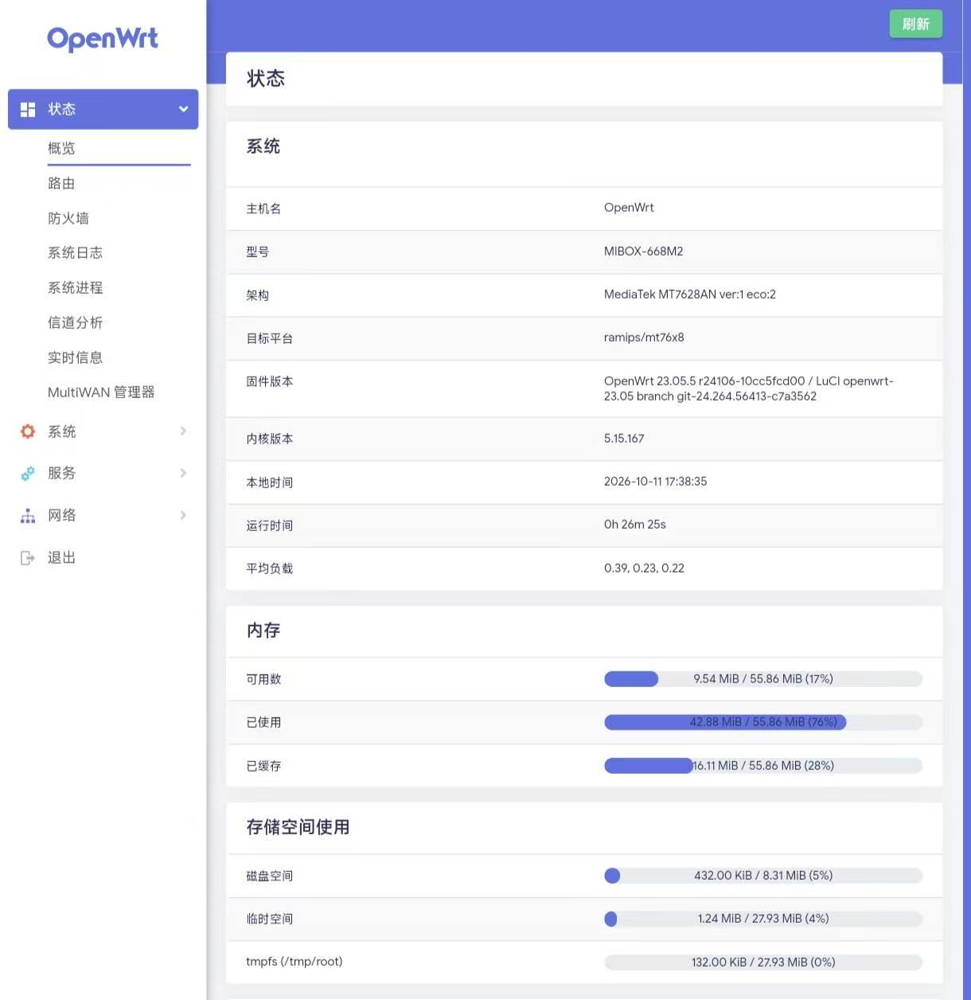
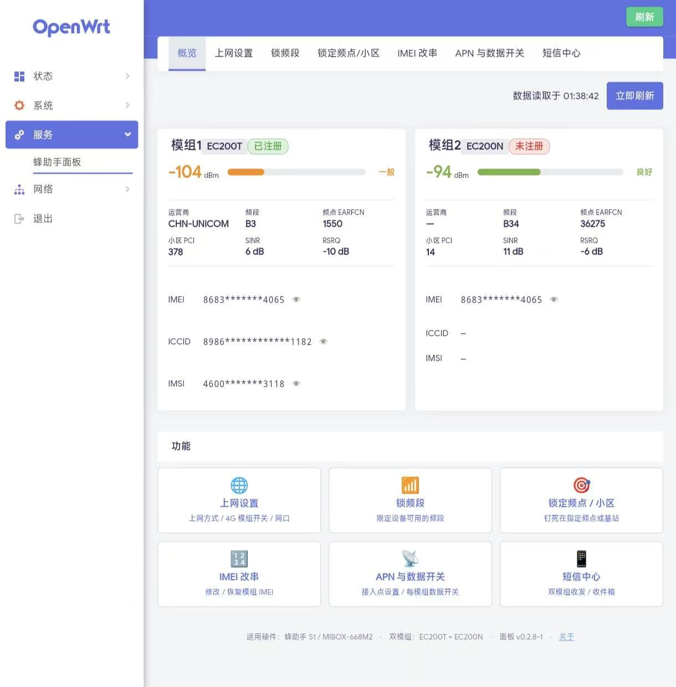

<!--
[For AI / contributors; invisible on GitHub]
This is the PUBLIC readme (GitHub landing page), written for end users who want to flash the device.
★ Internal project docs (handover / progress / constraints / TODO) live in README.project.md — read it first.
★ Full history: 00_时间线.md and docs/00~08 (internal, never published).
⚠️ Do not merge internal docs into this file, and never overwrite README.project.md with it.
-->

# FZS S1 OpenWrt Firmware · fzs1-openwrt

> **Custom-built OpenWrt firmware for the "蜂助手 S1" (MIBOX-668M2) dual-modem 4G CPE —
> dual-modem 4G internet + a Chinese cellular-management panel, all in one flash.**
> Based on OpenWrt 23.05 (kernel 5.15). Verified: dual Quectel EC200 modems over RNDIS, mwan3 load balancing, ready-to-use Chinese panel.

**Language / 语言：** [简体中文](README.md) · English

**Keywords:** `FZS S1` / `MIBOX-668M2` / `MT7628DAN` 4G CPE, `Quectel EC200T` / `EC200N`,
OpenWrt 23.05 (ramips/mt76x8), dual-modem RNDIS, `mwan3`, LuCI, SMS forwarding.

> ⚠️ **Flashing carries risk — read the [Disclaimer](#disclaimer) first.** This project **does not modify IMEI** and contains no cloud-control or backdoor.

> 📦 **Download firmware:** [Releases](../../releases/latest) → pick the latest → download `*squashfs-sysupgrade.bin`.

> 💚 **This project is completely free and open source.** If you paid for it, stop and report it via a repo Issue.

---

## Screenshots

**OpenWrt status page** (firmware info / memory / storage):



**FZS panel · Overview** (dual-modem status + feature entries, built-in LuCI panel):



> Both modems' signal / operator / band / cell at a glance; entries for network setup, band lock, cell lock, IMEI, APN, SMS center, and more.

---

## What is this

**A complete, flashable OpenWrt firmware** tailored for the "FZS S1" dual-SIM 4G CPE:

- **Base**: OpenWrt 23.05.5 (kernel 5.15.167), official `ramips/mt76x8` target, opkg works;
- **Hardware adaptation**: board-specific device tree (DTS) + board scripts wiring up both EC200 modems, I2C power-up, port mapping, and LEDs;
- **Dual-modem internet**: both modems over RNDIS with `mwan3` load balancing;
- **Built-in Chinese panel**: `luci-app-fzs` is integrated — **open the web UI right after flashing**, no extra ipk needed.

In one line: **flash once = new base + ready panel.**

## Hardware

| Item | Spec |
|---|---|
| SoC | MediaTek **MT7628DAN** (ramips / mt76x8) |
| Storage | **16MB** SPI-NOR flash / **64MB** DDR2 |
| Modems | Quectel **EC200T** (CAT4) + **EC200N** (CAT1), powered via I2C chip @0x39 |
| Wi-Fi | **2.4GHz** only |
| Ethernet | **3× RJ45** (**2× LAN + 1× WAN**, MT7628 built-in switch) |

## Why self-compiled

- **22.03 is too old** — upstream security updates have stopped;
- **24.10 (kernel 6.6) is unusable on this board** in testing — slow boot, poor USB re-enumeration tolerance; archived;
- **23.05 (kernel 5.15)** is the sweet spot: official target *and* stable on this board;
- **Self-compiled = every line controllable**, solving the trust-chain problem of "someone else's binary".

## Features

| Feature | Notes |
|---|---|
| Dual-modem RNDIS | `rndis-modem1` / `rndis-modem2`, stable names, co-gateway routing handled |
| Load balancing | `mwan3` policy `balanced`, 50/50, automatic online detection |
| Chinese panel | Overview / APN / band lock / cell lock / IMEI / data switch / SMS center |
| SMS forwarding | WeCom / DingTalk / Feishu / Telegram / webhook channels |
| Web UI | LuCI (Argon theme, Chinese), `http://192.168.1.1/` |
| Slim image | Removed ttyd / OpenSSL / dbus; overlay free space ≈ 8MB |

## Install (flashing)

1. Make sure the device **already boots** OpenWrt (community or an older build of this firmware);
2. Download `openwrt-ramips-mt76x8-mibox_668m2-squashfs-sysupgrade.bin` from [Releases](../../releases/latest);
3. **Web**: LuCI → System → Backup/Flash Firmware → choose the file → flash;
   **CLI**: `sysupgrade -F -n /tmp/<firmware>.bin` (`-n` wipes config; recommended across versions);
4. Wait ~1.5–2 min, then browse to `http://192.168.1.1/`.

### First login

| Item | Value |
|---|---|
| Address | `http://192.168.1.1/` |
| Username | `root` |
| **Password** | **`admin`** |
| **Wi-Fi SSID** | **`FZS-S1`** |
| **Wi-Fi password** | **`1234567890`** |

> ⚠️ **Security**: these are defaults — **change the admin and Wi-Fi passwords right after first login** (LuCI → System → Administration / Network → Wireless).

## One-click rescue package

The rescue package is a small Windows tool: extract it and run `一键救砖.bat`. It sets up a TFTP
server on your PC, then works together with the recovery path built into the device to write the
firmware back, bringing the device back to a working state — **no disassembly, no serial cable**.

**This is an emergency measure, not the normal way to flash.** If the device still boots into its web
UI, flash from the web page instead (see the previous section).

It works because the device's bootloader (u-boot) contains a factory-grade TFTP recovery path:
holding the reset key while powering on makes it download firmware from `192.168.1.3` and write it to
flash by itself. This tool simply runs that TFTP server on your PC.

### Steps (~5 minutes)

1. Download **`FZS-S1-Rescue-v1.zip`** from [Releases](../../releases) and extract it anywhere;
2. Connect the PC to the device with an Ethernet cable (any **LAN** port), then run `一键救砖.bat`
   (recommended: right-click -> **Run as administrator**);
3. Follow the on-screen prompts: **power the device off -> poke the reset hole with a SIM-pin ->
   plug the power back in and keep holding for ~3 s**.

Everything after that is automatic: download -> flash write -> auto reboot.
**Do not cut power or unplug the cable during the process.**
After ~5 minutes open `http://192.168.1.1`; if the login page appears, recovery succeeded.

### FAQ

| Question | Answer |
|---|---|
| **First boot is slow** | Normal. The device rebuilds its config area (~2-3 min) and may auto-reboot once |
| **The tool shows no reaction** | Check: (1) the cable is in a **LAN** port (not WAN) (2) the tool window shows the TFTP service started (3) you ran it as **administrator** (4) reset really was poked with a pin |
| **Will it brick the device?** | No. The bootloader is never written; as long as it is intact the recovery path stays available |
| **What system will it install?** | This project's OpenWrt firmware. You can flash anything else from the web UI afterwards |

> Warning: use it only on hardware you legally own. The tool touches **wired NICs only** and never your Wi-Fi.

---

## Build from source

You **do not** need to fork the OpenWrt main tree — scripts inject the customizations into the official source.

```bash
# 1) Prepare (WSL2 / Linux, Ubuntu 22.04+)
sudo apt-get install -y build-essential clang flex bison g++ gawk gcc-multilib \
  g++-multilib gettext git libncurses5-dev libssl-dev python3-setuptools rsync \
  swig unzip zlib1g-dev file wget time libelf-dev

# 2) One-shot build (clone → inject board+panel → defconfig → build)
bash build.sh

# Output: build/openwrt-ramips-mt76x8-mibox_668m2-squashfs-sysupgrade.bin
```

> Steps: `bash build.sh clone|inject|config|build`.
> The panel (luci-app-fzs) is fetched from the sister project [fzs1-panel](../../../fzs1-panel)
> Release by default; or set `FZS_PANEL_IPK=/path/to/*.ipk bash build.sh inject`.

> **GitHub Actions online build** is supported (see `.github/workflows/build.yml`) —
> run manually or push a tag to auto-attach the firmware to a Release.

## Repository layout

```
fzs1-openwrt/
├── README.md / README.en.md   # this file (zh / en)
├── LICENSE                    # GPL-3.0
├── build.sh                   # ★ one-shot build (clone → inject → config → build)
├── src/                       # ★ customizations: DTS + board files + config
│   ├── mt7628an_mibox_668m2.dts        # board device tree
│   ├── config.seed.v2                  # OpenWrt config seed
│   ├── board-files/                    # board files (init.d / uci-defaults / hotplug)
│   └── luci-app-fzs.Makefile           # packaging of the built-in panel
├── patches/                   # board patches (if any)
├── .github/workflows/         # online build (GitHub Actions)
└── build/                     # build output (git-ignored; releases host the binaries)
```

> The built-in panel's **source** lives in the sister project [fzs1-panel](../../../fzs1-panel);
> this repo fetches its ipk from that project's Release during build.

## Known limitations

- **NET LED stays off**: the blue NET LED (GPIO37) proved **software-uncontrollable** in
  full testing (the community firmware doesn't drive it either); tied to vendor-private board
  init. **Not fixed here** (no functional impact).
- **2.4GHz Wi-Fi only** — hardware limit.
- **16MB flash** — limited overlay; mind large plugins.

## FAQ

**Q: Can it brick? Can I go back to stock?**
A: A failed sysupgrade usually still leaves uboot/recovery reachable; the stock-restore path is in the project docs (if provided).

**Q: Can I install other plugins?**
A: Yes. It's standard OpenWrt 23.05 — `opkg update && opkg install <pkg>` (needs opkg feed reachability).

**Q: Why flash with `-n` (wipe config)?**
A: Across versions/large changes, old config may be incompatible; `-n` is safest.

## Credits

- The **OpenWrt** project and the `ramips/mt76x8` community;
- The **community firmware author** — this project's board adaptation (dual-modem RNDIS, mwan3, I2C power-up) builds on their prior work;
- The **fzs1-panel** (sister project) author — the Chinese management panel.

## Disclaimer

- Provided **"as is", without warranty of any kind**. Flashing may render your device unusable; use at your own risk.
- This project **does not modify IMEI, contains no cloud-control, and collects no user data**.
- Use it only on devices **you legally own**.
- To the maximum extent permitted by law, the author is not liable for any direct or indirect damages.

## License

[GPL-3.0-or-later](LICENSE). Built upon OpenWrt and its open-source components under their respective licenses.
